# Drone Mission Platform - Yol Haritası ve Görev Dağılımı

Bu proje 2 kişilik yazılım ekibi (Kişi A & Kişi B) için 3 günlük geliştirme maratonu şeklinde tasarlanmıştır.

---

## 👥 Ekip Rol Dağılımı Özeti

| Rol | Sorumlu | Ana Odak Alanları |
| :--- | :--- | :--- |
| **Kişi A** | Backend & MAVLink Mühendisi | FastAPI, MAVLink protokolü (pymavlink), PX4 SITL/Gazebo köprüsü, durum makinesi, CSV kaydı |
| **Kişi B** | Frontend & UI/UX Mühendisi | React 18, Leaflet haritası, Zustand state yönetimi, WebSocket canlı telemetri, Nginx dağıtımı |

---

## 📌 Aşamalar ve İş Sıralaması

```mermaid
flowchart TD
    Contract["0. Arayüz Sözleşmesi (API.md)<br><b>Her İki Kişi</b>"] --> PkgA["İş Paketi A: Backend & PX4<br><b>Kişi A</b>"]
    Contract --> PkgB["İş Paketi B: Frontend & Harita<br><b>Kişi B</b>"]
    
    subgraph S_A ["Kişi A Akışı"]
        A1["A1. Docker Ortamı"] --> A2["A2. Config & Modeller"]
        A2 --> A3["A3. Validator (TDD)"]
        A3 --> A4["A4. Converter (TDD)"]
        A4 --> A5["A5. MAVLink Bağlantı & Telemetri"]
        A5 --> A6["A6. Görev Yükleyici (Uploader)"]
        A6 --> A7["A7. Durum Makinesi"]
        A7 --> A8["A8. CSV Kaydedici"]
        A8 --> A9["A9. REST & WS Endpoint'leri"]
    end

    subgraph S_B ["Kişi B Akışı"]
        B1["B1. Proje İskeleti (Vite+TS)"] --> B2["B2. Zustand Store (TDD)"]
        B2 --> B3["B3. API Client & WS Hook"]
        B3 --> B4["B4. Leaflet Haritası & Çizim"]
        B4 --> B5["B5. Waypoint Paneli"]
        B5 --> B6["B6. Telemetri Paneli"]
        B6 --> B7["B7. İHA İkonu & Uçuş İzi"]
        B7 --> B8["B8. Kontrol Çubuğu (Yükle/Başlat)"]
        B8 --> B10["B10. Frontend Docker & Nginx"]
    end

    PkgA --> Int["5. Entegrasyon & Uçtan Uca Test (E1, E2, E3)<br><b>Her İki Kişi</b>"]
    PkgB --> Int
    Int --> Release["v0.1.0 Sürüm Teslimi"]
    
    Int -.-> PkgC["İş Paketi C: AprilTag Tespiti (Opsiyonel)<br><b>Zaman Kalırsa</b>"]
```

---

## 📋 Detaylı İş Paketleri ve Kabul Kriterleri

### [Kişi A] İş Paketi A: Backend & Simülasyon
- [ ] **A1. Docker Ortamı**
  - Dosyalar: `docker-compose.yml`, `backend/Dockerfile`, `backend/pyproject.toml`
  - Kabul: `docker compose up px4-sim backend` ayağa kalkar, `curl localhost:8000/health` `{"px4": true}` döner.
- [ ] **A2. Config & Pydantic Modelleri**
  - Dosyalar: `backend/app/config.py`, `backend/app/models.py`
  - Kabul: `test_validator.py` içinde model testleri geçer.
- [ ] **A3. Görev Doğrulayıcı (Validator)**
  - Dosyalar: `backend/app/mission/validator.py`, `backend/tests/test_validator.py`
  - Kabul: 2 altı veya 20 üzeri nokta reddedilir, 4 test geçer.
- [ ] **A4. Görev Dönüştürücü (Converter)**
  - Dosyalar: `backend/app/mission/converter.py`, `backend/tests/test_converter.py`
  - Kabul: Lat/Lon 1e7 çarpanı, Takeoff (cmd 22) ve Waypoint (cmd 16) seq sırası 5 testle doğrulanır.
- [ ] **A5. MAVLink Bağlantısı & Telemetri**
  - Dosyalar: `backend/app/mavlink/connection.py`, `backend/app/mavlink/telemetry.py`
  - Kabul: GLOBAL_POSITION_INT, VFR_HUD ve HEARTBEAT mesajları birleştirilip 5 Hz Telemetry nesnesi oluşturulur.
- [ ] **A6. Görev Yükleyici (Uploader Protocol)**
  - Dosyalar: `backend/app/mission/uploader.py`, `backend/tests/test_uploader.py`
  - Kabul: MISSION_COUNT, MISSION_REQUEST_INT, MISSION_ACK döngüsü mock ve SITL ile çalışır.
- [ ] **A7. Durum Makinesi & Uçuş Kontrolü**
  - Dosyalar: `backend/app/mission/state.py`, `backend/tests/test_state.py`
  - Kabul: `idle -> uploaded -> flying -> completed` durum geçişleri kilitlerle korunur, Arm ve RTL komutları gönderilir.
- [ ] **A8. CSV Telemetri Kaydedici**
  - Dosyalar: `backend/app/recorder.py`, `backend/tests/test_recorder.py`
  - Kabul: `flights/<id>.csv` içine uçuş boyunca tüm telemetri satır satır dökülür.
- [ ] **A9. REST & WebSocket API Router**
  - Dosyalar: `backend/app/api/routes.py`, `backend/app/api/ws.py`, `backend/app/main.py`
  - Kabul: Test istemcisiyle `/mission`, `/mission/start`, `/ws/telemetry` uçtan uca doğrulanır.

---

### [Kişi B] İş Paketi B: Frontend & Arayüz
- [ ] **B1. Frontend Kurulumu & Tipler**
  - Dosyalar: `frontend/package.json`, `frontend/vite.config.ts`, `frontend/src/types/index.ts`
  - Kabul: `npm run build` hatasız tamamlanır, tipler API.md ile %100 eşleşir.
- [ ] **B2. Zustand Görev Store (TDD)**
  - Dosyalar: `frontend/src/store/missionStore.ts`, `frontend/src/store/missionStore.test.ts`
  - Kabul: Waypoint ekleme, silme, taşıma, irtifa değişimi, trail kapasitesi (max 200) testleri geçer.
- [ ] **B3. API Client & Telemetry Hook**
  - Dosyalar: `frontend/src/api/client.ts`, `frontend/src/hooks/useTelemetry.ts`
  - Kabul: Backend kapalıyken 2 saniyede bir yeniden bağlanma dener, telemetri anlık store'a akar.
- [ ] **B4. Leaflet Haritası & Rota Çizimi**
  - Dosyalar: `frontend/src/components/MissionMap.tsx`
  - Kabul: Haritada tıklamayla nokta eklenir, sürüklenir, noktalar polyline ile bağlanır.
- [ ] **B5. Waypoint Yönetim Paneli**
  - Dosyalar: `frontend/src/components/WaypointPanel.tsx`
  - Kabul: 10-500 metre arası irtifa doğrulama uyarısı kırmızı renkle verilir.
- [ ] **B6. Canlı Telemetri Paneli**
  - Dosyalar: `frontend/src/components/TelemetryPanel.tsx`
  - Kabul: Hız, irtifa, yön, arm durumu ve bağlantı rozetleri (yeşil/sarı/kırmızı) canlı güncellenir.
- [ ] **B7. Haritada Dönen İHA İkonu & Uçuş İzi**
  - Dosyalar: `frontend/src/components/MissionMap.tsx`
  - Kabul: İHA heading değerine göre kendi ekseninde döner, arkasında mavi uçuş izi çizgisi oluşur.
- [ ] **B8. Kontrol Çubuğu (Action Bar)**
  - Dosyalar: `frontend/src/components/ControlBar.tsx`
  - Kabul: Yükle, Başlat, İptal butonları durum makinesine göre `disabled` / `active` olur.
- [ ] **B10. Docker & Nginx Reverse Proxy**
  - Dosyalar: `frontend/Dockerfile`, `frontend/nginx.conf`
  - Kabul: `http://localhost:8080` portundan web arayüzü ve API yönlendirmeleri çalışır.

---

### [Ortak] İş Paketi E: Sistem Entegrasyonu & Teslimat
- [ ] **E1. Tam Uçtan Uca Senaryo**
  - Tarayıcıda 3 nokta çiz -> Gönder -> Başlat -> Simülasyonda İHA uçar -> Tamamlanır -> CSV dosyası üretilir.
- [ ] **E2. Hata ve Kurtarma Senaryoları**
  - Simülatörsüz `/health` uyarısı, geçersiz 21 nokta reddi, uçuş ortasında iptal (RTL).
- [ ] **E3. Kod Temizliği & Sürümleme**
  - Tüm backend/frontend testlerinin yeşil olması, Git tag `v0.1.0` basılması.
